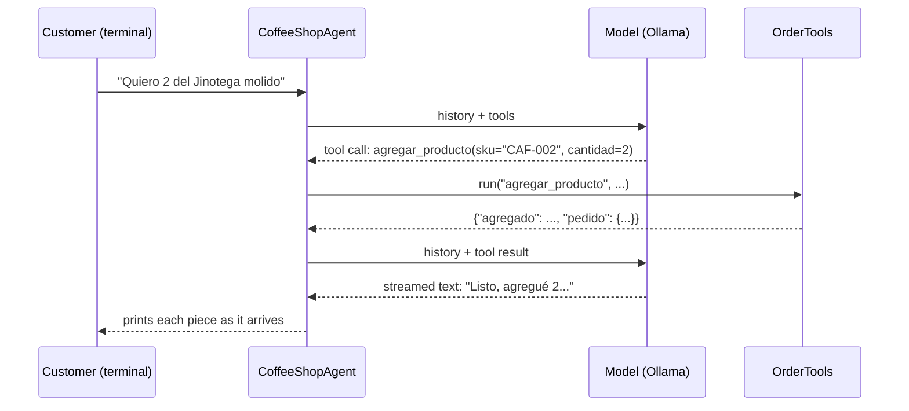

# 3. How it works

This guide explains what happens between the moment you press Enter and the moment the Barista
answers. It's the core idea of a tool-using agent, so it's worth reading slowly.

## The big idea: the model talks, the code decides

A small language model is good at understanding what a customer means and at writing a friendly
reply. It's bad at arithmetic and it can invent facts. So the work is split:

| The model does | The code does |
|----------------|---------------|
| Understands the customer's message | Stores the order |
| Decides which tool to call, with which arguments | Checks stock and SKUs |
| Writes the reply in Spanish | Computes every price, subtotal, shipping cost, and total |
| | Validates the department and the phone number |
| | Asks the customer to confirm before charging |

The model never computes a total. It calls a tool, the tool returns the numbers, and the model
repeats them. If the model makes a mistake, the worst case is a wrong tool call that the code
rejects; it can't produce a charge for the wrong amount.

## The modules

```text
__init__.py   terminal app ─┐
                            ▼
agent.py      CoffeeShopAgent (the loop) ──► Ollama (the model)
              OrderTools (the tools)
                            │
                            ▼
order.py      Order: lines, stock checks, totals
catalog.py    Catalog: products from data/catalogo.csv
shipping.py   quote_shipping(): rates from data/envios.csv
payments.py   create_pocket_charge(): simulated payment link
text.py       normalize() for accent-insensitive matching, cordobas() for C$ formatting
```

Domain modules (`order`, `catalog`, `shipping`, `payments`) know nothing about the model. You
can use and test them on their own.

## Step by step: one customer message

Take the message `Quiero 2 del Jinotega molido`.



1. **The message joins the history.** `CoffeeShopAgent.reply()` appends it to `self.messages`.
   The history starts with the system prompt (instructions plus the whole catalog) and holds
   every message of the conversation, so the model remembers context.
2. **The model sees the history and the tool list.** `_stream_message()` sends both to Ollama.
   Each tool is described with a JSON schema: its name, what it does, and its arguments.
3. **The model chooses: answer or call a tool.** Here it needs to change the order, so instead
   of text it returns a tool call: `agregar_producto` with `sku="CAF-002"` and `cantidad=2`.
   It knows the SKU because the catalog is in the system prompt.
4. **The code runs the tool.** `OrderTools.run()` finds the method `_tool_agregar_producto`,
   which calls `Order.add()`. That checks the SKU exists and that 2 units are in stock, then
   updates the order.
5. **The result goes back to the model.** The tool returns a dict (the updated order), which is
   added to the history as a `tool` message. If something failed, the dict is
   `{"error": "..."}` and the model explains the problem to the customer.
6. **The model answers.** With the tool result in the history, the model now writes text. The
   reply streams: each piece is printed as soon as it arrives.
7. **The loop ends** when the model replies with text instead of a tool call. If it keeps calling
   tools 8 times in a row (`MAX_TOOL_ROUNDS`), the agent stops and asks the customer to rephrase,
   so a confused model can't loop forever.

One customer message can mean several model calls: for example, quote shipping and then answer.
That's why replies that use a tool take a second or two longer to start.

## The tools

Defined in `TOOLS` (`agent.py`); each one maps to a `_tool_<name>` method in `OrderTools`.

| Tool | Arguments | What it does |
|------|-----------|--------------|
| `buscar_productos` | `consulta` (optional) | Searches the catalog by words, ignoring accents and case. |
| `agregar_producto` | `sku`, `cantidad` | Adds units, checking stock. |
| `quitar_producto` | `sku`, `cantidad` (optional) | Removes units, or the whole line without a quantity. |
| `ver_pedido` | none | Returns the order with subtotal, shipping, and total. |
| `cotizar_envio` | `departamento` | Quotes shipping for the current subtotal. |
| `generar_link_de_pago` | `nombre`, `telefono` | Validates the phone, asks the customer to confirm, creates the payment link. |

Tools treat their arguments like user input: an unknown SKU, a bad quantity, or an invalid
department returns an error instead of crashing.

## The system prompt

`SYSTEM_PROMPT` in `agent.py` tells the model who it is (Barista, warm and brief, in Spanish,
amounts as `C$ 147.00`), to trust tool results instead of estimating, and the four steps to
close a sale. `build_system_prompt()` appends the catalog, so the model knows the products
without spending a tool call.

## The confirmation box: why the app asks, not the model

When the model calls `generar_link_de_pago`, the tool calls `ask_customer_to_confirm()` before
creating the link. That function prints a summary computed by the code and reads `s/n` directly
from the customer.

The model could misread "sí, pero quita la taza" as a yes. The app reading the answer itself
means a charge only happens when the customer explicitly confirms the exact amounts shown.

## Streaming

`_stream_message()` asks Ollama for `stream=True`. The reply arrives in small pieces, and each
one is passed to the `on_text` callback, which the terminal prints right away
(`StreamedReply` in `__init__.py`). At the end, the pieces are joined into one message for the
history. The first words appear in under a second instead of waiting for the full reply.

## Two Ollama settings that matter

- **Context size** (`OPTIONS = {"num_ctx": 16384}`): Ollama's default is 4096 tokens. When a
  conversation grows past it, Ollama silently drops the oldest messages, including the system
  prompt and catalog, and the agent starts making things up. 16K tokens leaves room for long chats.
- **Model choice**: `qwen3:4b` reasons before every reply (more accurate, minutes per
  conversation). `qwen3:4b-instruct` answers directly (seconds). See
  [guide 5](05-testing-and-evals.md#results-so-far) for the measurements.

## Next

[Guide 4: Customizing](04-customizing.md) shows how to change the data, the model, and the prompt.
